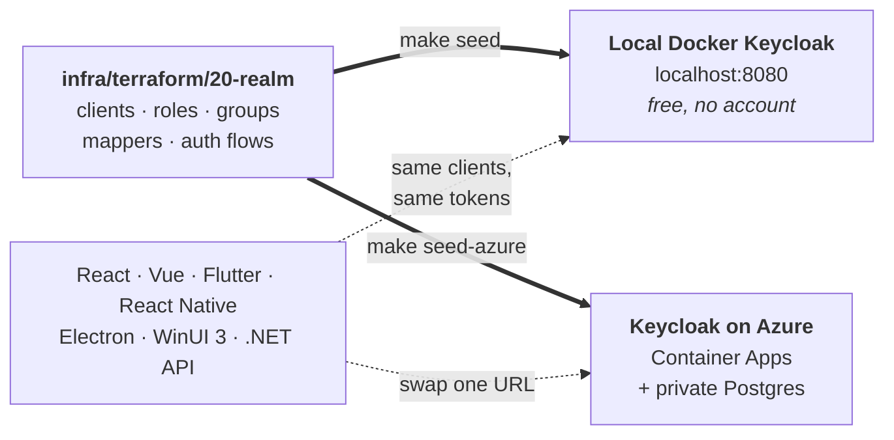
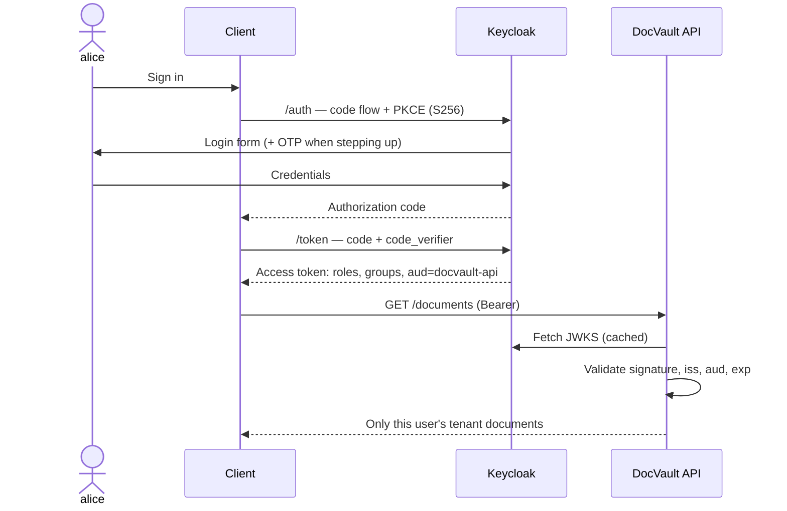
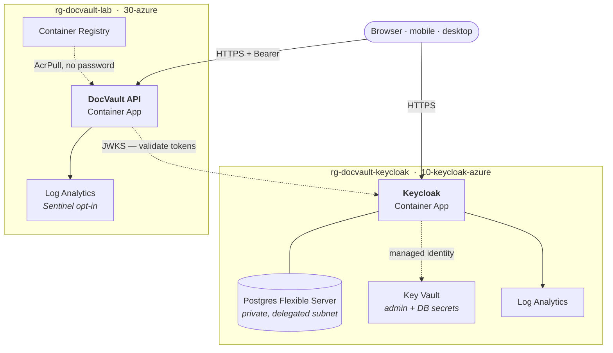

# DocVault — a Keycloak identity lab

[](https://github.com/MagnusJohansson/keycloak-poc/actions/workflows/ci.yml)
[](https://github.com/MagnusJohansson/keycloak-poc/actions/workflows/codeql.yml)
[](https://scorecard.dev/viewer/?uri=github.com/MagnusJohansson/keycloak-poc)
[](LICENSE)

**TL;DR:** A working identity lab built around Keycloak 26, small enough to run
on a laptop and complete enough to show the decisions an identity platform needs.

- **The realm is code.** One Terraform module defines clients, roles, groups,
  mappers and login flows, and applies unchanged to a local Docker Keycloak and
  to Keycloak on Azure Container Apps. CI applies it to a real Keycloak on every run.
- **One API, eight kinds of client.** A .NET 10 API validates tokens for React,
  Vue, Flutter, React Native, Electron and WinUI 3 clients, a background worker,
  and an AI assistant.
- **Access control in layers.** Role-based access, tenant isolation, step-up MFA
  (RFC 9470), service-to-service calls, consent, and an audit trail to Azure Sentinel.
- **Sharing a document with OpenFGA.** A document can be private to its owner,
  who shares it with a person or a department. OpenFGA decides per document;
  Keycloak stays the only place membership lives, sent with every check from the
  token. Checked with a person moved and renamed in the directory, and with
  OpenFGA switched off: the API answers 503, never "allow".
- **People from a directory.** LDAP user federation against an OpenLDAP
  container, read-only and over TLS: the directory says who someone is and where
  they belong, the realm says what that allows. Checked for what happens when a
  person moves or leaves.
- **A legacy SAML provider, brokered.** People who still sign in at an older
  SAML identity provider reach the same API with the same tokens; SAML stops at
  Keycloak. Checked with responses that were stripped, altered, wrapped,
  replayed or issued for someone else.
- **A legacy SAML application, kept working.** An application that speaks only
  SAML signs its people in through Keycloak. It refuses responses that are
  correctly signed and still wrong: expired, for another application, answering
  someone else's request, or used twice.
- **An AI assistant as a client.** An MCP server with audience-bound tokens,
  consented scopes and token exchange, so an assistant can do only what the user
  consented to, as that user. An audit log records each call: who, through which
  client, which tool, and how it ended.
- **Tested against the real thing.** 314 .NET tests with forged tokens and forged
  SAML responses, browser
  tests against a real Keycloak, and end-to-end checks that sign in as the demo users.

It is a lab, not a product: the demo passwords are published, the MCP part
relies on an experimental Keycloak feature, the directory is a small OpenLDAP
container, not Active Directory, and the legacy SAML provider is a second
Keycloak realm, not another vendor's product.
[What has and has not been verified](#verified) is listed below.

---

A runnable proof of concept for [Keycloak](https://www.keycloak.org/), the
open-source identity and access management server. It covers running Keycloak,
configuring a realm as code, deploying to Azure, and integrating it with web,
mobile, desktop and backend clients.

**The local lab runs on your machine, for free** — Docker, .NET and Node, no cloud
account. The realm is defined once in Terraform and applied unchanged to either
that local Keycloak or an Azure deployment, so the free local lab is a faithful
rehearsal for the cloud one rather than a simplified toy.

Deploying to Azure is optional and does need a subscription; it costs roughly
$40/month while it is running, and `make azure-destroy` removes all of it.




## Prerequisites

For the local lab — everything in the Quickstart below:

| Tool | Version | Why |
|---|---|---|
| **Docker** | with Compose v2 | runs Keycloak, Postgres, the LDAP directory and Mailpit |
| **Terraform** | **≥ 1.9** | applies the realm — `make seed` *is* Terraform, not a script |
| **.NET SDK** | **10.0** | the API, the worker and the test suite |
| **Node** | **20.19+ or 22.12+** | the React and Vue clients (Vite 8 requires it) |

**macOS**

```bash
brew install --cask docker
brew tap hashicorp/tap && brew install hashicorp/tap/terraform
brew install --cask dotnet-sdk
brew install node
```

**Windows**

```powershell
winget install Docker.DockerDesktop
winget install Hashicorp.Terraform
winget install Microsoft.DotNet.SDK.10
winget install OpenJS.NodeJS
```

Terraform is the one people miss: it is not bundled, and `make seed` fails
without it. Check with `terraform version`.

> On macOS the `brew tap` step is required — `terraform` is no longer in
> homebrew-core (it moved to HashiCorp's own tap after the licence change), so
> plain `brew install terraform` fails with *"No available formula"*. Other
> platforms: [terraform.io/install](https://developer.hashicorp.com/terraform/install).

> `make` is preinstalled on macOS but not on Windows. Use
> `winget install GnuWin32.Make`, run the lab from WSL, or read the Makefile and
> run the underlying commands directly — they are all one-liners.

Only for the parts you actually try:

| Doing what | Also needs | macOS | Windows |
|---|---|---|---|
| Deploying to Azure | Azure CLI, logged in | `brew install azure-cli` | `winget install Microsoft.AzureCLI` |
| The e2e tests | Playwright browsers | `npx playwright install chromium` | same |
| The Flutter client | Flutter (Dart SDK ≥ 3.13) | `brew install --cask flutter` | [docs.flutter.dev/install](https://docs.flutter.dev/install) — not in winget |
| The WinUI 3 client | **Windows only** | not possible — XAML does not compile off Windows | .NET 10 SDK; see the note below |

> **WinUI 3 build requirements.** CI builds it on `windows-latest`, which ships
> Visual Studio Enterprise 2022 — so a build with *only* the .NET SDK is
> untested. If `dotnet build` alone fails, install Visual Studio 2022 with the
> **Windows application development** workload, which is the documented path.

Docker, .NET, Node and Terraform are enough for the local lab and the full test
suite — no account, paid or otherwise. Only the optional Azure deployment
(Steps 1–6 of the [deployment guide](docs/09-deploying-on-azure.md)) needs a
subscription.

## Quickstart

```bash
make up      # Keycloak + Postgres + the directory + OpenFGA + Mailpit  (~30s)
make seed    # apply the DocVault realm, and the OpenFGA store and model, via Terraform
make api     # .NET 10 API on :5001
make web     # React SPA on :5173   (in another shell)
```

`make web` creates `apps/web-react/.env` from its `.example` on first run — the SPA
reads `VITE_*` variables and throws at import time without them, which shows up as a
blank page rather than an error.

The root `.env.example` is a separate thing, for the shell tools (`make token`,
`tools/*.sh`) rather than the apps. Copy it if you use them: `cp .env.example .env`.

Sign in as **alice** / `DocVaultLab!2026`. `make help` lists everything.

The Keycloak admin console is at <http://localhost:8080/admin> (`admin`/`admin`) —
note it opens on the `master` realm, so switch to **`docvault`** to see the demo
users and clients.

## How a sign-in actually flows

Every client here does the same thing — authorization code + PKCE through a real
browser, then a bearer token the API validates itself. No client ever sees a
password, and the API never calls Keycloak to check a request.



The two steps that fail *silently* when misconfigured are both visible here: the
audience mapper (`aud=docvault-api`) and the roles/groups claims. Without them
sign-in still succeeds and every API call returns 401 or 403.

## Deploying to Azure

The whole lab also runs on Azure: Keycloak on Container Apps with a private
Postgres, configured by the same Terraform that configures your local container.




Azure adds a third, platform-managed resource group (`ME_...`) for the VNet-integrated
Container Apps environment's load balancer. That is expected, not drift.

**→ [Step-by-step deployment guide](docs/09-deploying-on-azure.md)** — six steps,
each with a verification command, plus costs and teardown.

You can stop after step 3 and have cloud Keycloak driving your local apps for
about $40/month; `make azure-destroy` removes everything. Pick your region with
`export TF_VAR_location=<region>` before the first apply — it defaults to
`swedencentral`.

## Running from VS Code

`.vscode/launch.json` has an F5 target for every runnable app — Flutter (iOS
simulator / Android emulator / Azure), the API (local or Azure), Electron, the
worker, and the React SPA. Tasks cover `lab: up + seed` and the Vite dev server.

The Android target also runs `make android-reverse` first, which points the
emulator's own `localhost` at your machine. That is not a convenience: Keycloak
derives the token issuer from the request host, so reaching it as `10.0.2.2`
mints tokens the API rejects. Running Flutter from the command line? Run
`make android-reverse` yourself after starting the emulator.

The Azure variants read files you create and that are gitignored
(`config/azure.json`, `appsettings.Azure.json`, `apps/desktop-electron/config.json`,
`apps/web-react/.env`), so no deployment URL is committed. Copy the matching
`.example` to get started.

## What it demonstrates

| # | Scenario | Where |
|---|---|---|
| 1 | RBAC + tenant isolation, and per-document sharing decided by OpenFGA with membership from the token (local lab; Azure runs tenant-wide only) | [uc1](docs/use-cases/uc1-rbac-document-sharing.md), [chapter 14](docs/14-fine-grained-authorization.md) |
| 2 | Enterprise SSO — Entra ID federated as an external OIDC IdP | [uc2](docs/use-cases/uc2-enterprise-sso-entra.md) |
| 3 | Step-up MFA — `acr_values`, RFC 9470 challenge, conditional OTP | [uc3](docs/use-cases/uc3-step-up-mfa.md) |
| 4 | Machine-to-machine — `client_credentials`, service accounts | [uc4](docs/use-cases/uc4-service-to-service.md) |
| 5 | Consent + data minimisation — pairwise subject identifiers | [uc5](docs/use-cases/uc5-consent-and-privacy.md) |
| 6 | Audit → SIEM → Azure Sentinel | [uc6](docs/use-cases/uc6-audit-siem-sentinel.md) |
| 7 | People from an LDAP directory — read-only user federation over TLS, directory groups mapped onto the realm's groups, and what happens when someone moves or leaves (local lab; OpenLDAP) | [uc7](docs/use-cases/uc7-ldap-directory.md) |
| 8 | Moving off a legacy SAML identity provider — Keycloak brokers it, maps its groups, and refuses responses that were stripped, altered, wrapped or replayed (local lab; the provider is a stand-in realm) | [uc8](docs/use-cases/uc8-saml-legacy-idp.md) |
| 9 | A legacy application that only speaks SAML — Keycloak as its identity provider, and the checks a SAML library leaves to the application (local lab; the application is a stand-in) | [uc9](docs/use-cases/uc9-saml-application.md) |
| 10 | An AI assistant as a client — an MCP server with audience-bound tokens, consented scopes, token exchange, and an audit log of what the assistant did and for whom (local lab; uses an experimental Keycloak feature) | [MCP](docs/13-integration-mcp.md) |

## Repository map

```
docs/                     the guide - start at 00-what-keycloak-is.md
infra/
  terraform/10-keycloak-azure/  Keycloak on Azure       (azurerm)
  terraform/20-realm/           realm config            (keycloak/keycloak)  <- source of truth
  terraform/25-openfga/         OpenFGA store + model   (openfga/openfga)    local lab + CI
  openfga/                      the model (docvault.fga) and its tests
  terraform/30-azure/           your apps on Azure      (azurerm)
  local/                        docker-compose lab, and the OpenLDAP directory it builds
apps/
  api-dotnet/             .NET 10 resource server + worker + tests
  mcp-dotnet/             MCP server for AI assistants (resource indicators, token exchange) + tests
  saml-reports/           a legacy application that only speaks SAML (Keycloak as its IdP) + tests
  web-react/              full reference client (PKCE, RBAC, step-up, TokenInspector)
  web-vue/                runnable-lite
  mobile-flutter/         runnable-lite  (flutter_appauth + Keychain/Keystore)
  mobile-react-native/    auth module    (react-native-app-auth)
  desktop-electron/       runnable-lite  (loopback PKCE, tokens never in the renderer)
  desktop-winui/          WinUI 3 / .NET 10 (Duende OidcClient, DPAPI) + cross-platform auth lib
tests/e2e-playwright/     browser login -> API call
tools/                    export-realm.sh, decode-token.sh, and the end-to-end checks (assert-*.py)
```

## The idea worth stealing

The realm lives in Terraform, not in the admin console. One module targets any
Keycloak:

```bash
make seed         # local Docker Keycloak
make seed-azure   # Keycloak on Azure
```

Same realm; only a URL and a credential differ. (The local lab also switches on
two optional parts, its LDAP directory and a stand-in legacy SAML provider,
which add 33 resources. Azure has neither.) Two consequences worth having:

- **The local lab is faithful.** If it stops being so, `make seed` fails
  immediately instead of during a migration.
- **Console drift is a test failure.** `make plan` should be empty; when someone
  changes something by hand, CI says so.

CI applies the module to a real Keycloak on every run, so the claim is checked
rather than asserted.

## Verified

Built and checked against real software, not just written down:

- 130 Terraform resources applied to the local Keycloak 26.6.3, and 2 to OpenFGA, with a clean re-plan
  (the Azure deployment was applied with the 74 that existed before the MCP server,
  the directory and the SAML provider);
  `acr_values_supported`, the audience mapper and service-account roles confirmed
  in a real token.
- .NET 10 API: 94 tests pass, including forged `alg:none`, wrong-key,
  wrong-audience, wrong-realm and expired tokens, 403-vs-401 for an
  authenticated-but-unauthorized caller, 404-not-403 across the tenant
  boundary, and what the API sends OpenFGA and does with each answer.
- Sharing: the OpenFGA model passes 30 checks on OpenFGA's own engine
  (`make test-model`), and `make assert-fga` passes 45 checks against the local
  Keycloak, directory, OpenFGA and API: private documents, shares to a person and
  a department, a revoke, a directory person moved and renamed, and OpenFGA
  frozen. **Local lab and CI only**; Azure runs without OpenFGA.
- Desktop auth library: 57 tests pass on macOS/Linux. **Both desktop clients have
  been run end-to-end against the Azure deployment** — WinUI 3 on Windows and
  Electron on macOS — with system-browser sign-in, correct issuer, audience and
  roles in the token, and tenant-scoped documents returned. The WinUI shell is
  also compiled by the `windows-latest` CI job.
- Keycloak on Azure and the API on Container Apps are both applied and running,
  not merely planned.
- 11 Playwright tests pass in a real browser (Chromium) against real Keycloak,
  among them a person from the LDAP directory, one from the legacy SAML
  provider, a sign-in to the legacy SAML application, and a private document
  shared with carol and unshared.
- MCP server: 115 tests pass with forged tokens (wrong audience, `alg:none`,
  wrong key, wrong realm, expired), every scope challenge, the share tools and
  the audit log, and `make assert-mcp` passes 41 checks against the local Keycloak, API and MCP
  server, signing in as the demo users. The last eight read the audit log the
  server wrote about those sign-ins, and match one call to Keycloak's events and
  to the API's own log. Driven from Claude Code as a real
  client: sign-in, consent, a tool call, and the scope step-up when a tool
  needed `docvault:write`. **Local lab and CI only**: it needs
  Keycloak's experimental `resource-indicators` feature, which the Azure module
  does not enable.
- LDAP federation: `make assert-ldap` passes 53 checks against the local
  Keycloak, API and an OpenLDAP container, signing in as people who exist only
  in the directory and then changing the directory under Keycloak (a mover, a
  leaver, an outage, a person taking someone else's name or address). Run from an empty Keycloak as well as on an upgraded
  realm. **Local lab and CI only**, and OpenLDAP only: nothing here has been run
  against Active Directory.
- Brokered SAML provider: `make assert-saml` passes 43 checks against the local
  Keycloak and API, signing in through a stand-in legacy SAML provider and then
  handing DocVault responses that were stripped of their signatures, altered,
  wrapped, replayed, or issued for another service. **Local lab and CI only**,
  and the provider is a second Keycloak realm: nothing here has been run
  against another vendor's SAML product.
- Legacy SAML application: 48 tests pass against an identity provider the tests
  control, with responses that are unsigned, signed by another key, changed,
  wrapped, expired, for another application, from another issuer, addressed
  elsewhere, readdressed on their unsigned envelope, unasked for, or used
  twice. Of nineteen deliberate breaks of its checks, eighteen failed a test
  and one is a second line behind another check. `make assert-saml-app` passes
  30 checks against the real Keycloak. **Local lab and CI only**; the application is a stand-in written
  for the lab, tried in Chromium only.
- React and Vue build; Flutter analyzes clean and its tests pass.
- The Flutter client has been driven end-to-end on an Android emulator against the
  local lab, and React against the full Azure stack (cloud Keycloak *and* cloud API).

## Releases

Releases are tagged from `main` and listed on the
[Releases page](https://github.com/MagnusJohansson/keycloak-poc/releases), with
notes in [CHANGELOG.md](CHANGELOG.md). A lab has nothing to install, so a release
is a fixed point to cite: the source as it was, tested, at that tag.

Each release attaches the source archive, its SHA-256 checksum and a signed build
provenance attestation. To check that an archive was produced by this
repository's release workflow from that tag:

```bash
gh attestation verify docvault-v1.0.0.tar.gz \
  --repo MagnusJohansson/keycloak-poc \
  --signer-workflow MagnusJohansson/keycloak-poc/.github/workflows/release.yml \
  --source-ref refs/tags/v1.0.0
```

Without the last two flags the command shows only that *some* workflow in this
repository attested the file. Add
`--bundle docvault-v1.0.0.tar.gz.sigstore.json` to verify against the bundle
attached to the release instead of fetching the attestation from GitHub.

What the signature does not show is the branch. The release workflow refuses a
tag that is not on `main`, which guards against a mistake; the attestation
itself records the workflow and the tag. `--signer-workflow` pins the workflow's
path, not its content; add `--source-digest <commit>` to pin the commit as well.

## How this was built

I built this lab with Claude Code as a pair programmer, and the commit history
says so. The discipline that matters is checking the output, so the claims here
are tested against real software and not only written down: see
[Verified](#verified). Changes are also reviewed by something other than the
session that wrote them: the pull requests of August and September 2026 by
GitHub Copilot, and the MCP server and the release workflow by a second,
independent Claude session. The design decisions, and the responsibility for
what is here, are mine.

## Licence

GPL-3.0-or-later — see [LICENSE](LICENSE).

Every hand-written source file carries a four-line SPDX header naming the copyright holder
and the licence. `make license-check` verifies it, and CI fails on a file that is missing one.
