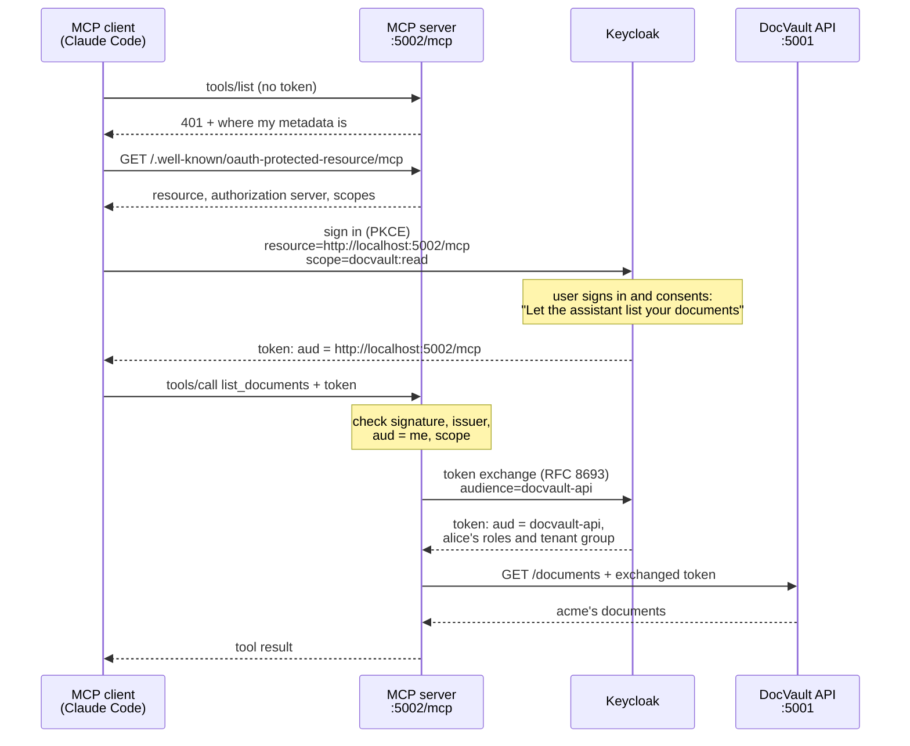

# AI assistants (MCP)

Source: `apps/mcp-dotnet/`, realm objects in `infra/terraform/20-realm/mcp.tf`.

An [MCP](https://modelcontextprotocol.io) server gives an AI assistant tools. This
one gives it three, over the DocVault API: `list_documents`, `create_document`
and `delete_document`. The interesting part is not the tools. It is that an
assistant is a new kind of client: the user did not write it, cannot read its
reasoning, and it takes instructions from whatever it reads. So the question this
chapter answers is: **what is the assistant allowed to do, on whose behalf, and
who enforces that?** And afterwards: **how do you know what it did?**

```bash
make up && make seed && make api     # as before
make mcp                             # the MCP server on :5002
make assert-mcp                      # 34 checks against the real stack
```

Then, from Claude Code:

```bash
claude mcp add --transport http --client-id docvault-mcp-client docvault http://localhost:5002/mcp
```

Run `/mcp`, authenticate as `alice`, approve the consent screen, and ask for your
documents. Then ask it to create one. The first sign-in asked only for
`docvault:read`, so the server answers with a scope challenge and Claude Code
asks you:

> MCP server "docvault" needs additional permissions for this tool (it asked for
> the scope "docvault:write"). Re-authenticate now?

Say yes, consent to the extra permission in the browser, and the call is retried.

> **This is a lab, and part of it is experimental upstream.** It follows the MCP
> authorization specification of 2026-07-28. Keycloak 26.6 implements the part of
> that specification this design leans on, resource indicators (RFC 8707), as an
> **experimental** feature: `resource-indicators` in `KC_FEATURES`. It is switched
> on in `infra/local/docker-compose.yml` and **not** in the Azure module, so this
> chapter is verified against the local lab and CI only.

## Three parties



| Party | Keycloak object | What it holds |
|---|---|---|
| MCP client (the assistant's host) | `docvault-mcp-client`, public, PKCE, consent required | a token for the MCP server, with scopes and **no roles** |
| MCP server | a confidential client whose `client_id` **is its URL** | a secret, used only to exchange tokens |
| DocVault API | `docvault-api`, unchanged | nothing new: it validates tokens as before |

## Two layers of permission

| Layer | Says | Set by | Enforced by |
|---|---|---|---|
| **Scopes** `docvault:read` `docvault:write` `docvault:delete` | what the *assistant* may do | the user, on the consent screen | the MCP server |
| **Roles and tenant** `doc.reader` … `/acme/engineering` | what the *user* may do | an administrator, through groups | the API, as always |

A call succeeds only where both allow it. The lab's demo users show each edge
through the assistant, and `make assert-mcp` asserts every row:

| User | Scope granted | Call | Outcome |
|---|---|---|---|
| alice (editor) | read | `list_documents` | acme's documents |
| alice | read | `create_document` | **403 challenge**: the assistant lacks `docvault:write` |
| alice | read, write, delete | `delete_document` | refused by the API: the scope is there, the admin role is not |
| carol (admin) | read, delete | `delete_document` | deleted |
| bob (other tenant) | read | `list_documents` | globex's documents only |
| dave (no roles) | read | `list_documents` | refused by the API, reported as a tool error |

What a tool returns goes to the model as it is, and that includes document titles
other members of the tenant wrote. A colleague can put instructions in a title.
Nothing here can stop a model reading them; what limits the damage is the same two
layers. The assistant can do only what was consented to, as that user, and
`delete_document` is marked destructive so a client asks before running it.
Titles created *through the assistant* are refused if they contain control or
invisible characters; the API itself does not check, so a title stored by the web
app can still carry them, and `list_documents` returns it as it is.

The scope never widens what the user can do. Granting an assistant
`docvault:delete` does not make alice an administrator; it only means that *if*
she were one, the assistant could use that.

## The four checks the server makes

`Program.cs` and `Auth/` in `apps/mcp-dotnet/DocVault.Mcp`:

1. **The token was issued for this server, and only for it.** The audience must be
   the server's URL, compared exactly, and the only audience in the token. A
   DocVault API token, or a token for another MCP server in the same realm, has a
   good signature and issuer and is still refused.
2. **The metadata describes this server and nothing else.** One fixed document at
   `/.well-known/oauth-protected-resource/mcp` (RFC 9728) tells a client which
   authorization server to use.
3. **The token has the scope the tool needs.** If not, the answer is the challenge
   MCP specifies, `403` with `WWW-Authenticate: Bearer error="insufficient_scope",
   scope="docvault:write"`, so a client can ask the user for exactly that and retry.
4. **The token goes no further.** The server exchanges it (RFC 8693) for a token
   aimed at the API. The incoming token is never forwarded.

## The audit log

Scopes and roles decide what happens. The audit log is how you find out afterwards
what did: which user, through which client, which tool, and how it ended. The
server writes one JSON record per event, to its log (category
`DocVault.Mcp.Audit`) and, when `Audit:File` is set, to a JSON Lines file that
only its owner can read. `make mcp` writes `.lab/mcp-audit.jsonl`.

alice asks the assistant to delete a document. She consented to
`docvault:delete`, and she is not an administrator:

```json
{"time":"2026-11-17T19:27:48.107Z","seq":7,"event":"tool.call","outcome":"refused",
 "trace.id":"f6da9c982e69d1eaedba9d4e132c0fa2","client.address":"::1",
 "user.id":"044bcbe0-893b-46bb-9605-d19c6dc9c1ea","user.name":"alice",
 "client.id":"docvault-mcp-client",
 "scope":"openid docvault:delete docvault:write docvault:read email profile",
 "token.id":"onrtac:983c188e-…","session.id":"r3coYV5Q…",
 "tool":"delete_document","reason":"api_forbidden",
 "document.id":"34b57b70-199c-434c-aa4c-c3c665ee32ce"}
```

| Event | When | Outcome and reason |
|---|---|---|
| `tool.call` | a tool ran, or refused inside the tool | `ok`; `refused` (`api_forbidden`: the user's role; `exchange_refused`; `missing_scope`); `rejected` (`invalid_title`, `invalid_id`); `not_found`; `error` |
| `scope.challenge` | the 403: the token lacks the tool's scope | `refused`, with the tool and `scope.required` |
| `token.refused` | the 401: a token was presented and refused | `refused` (`invalid_audience`, `expired`, `invalid_issuer`, `invalid_signature`, …) |
| `request.refused` | a valid token, but a body the server will not read | `rejected` (`unreadable_body`, `too_large`) |

The two layers of permission stay apart in the record: `scope.challenge` means
the *assistant* was not allowed, `api_forbidden` means the *user* was not.

What a record may contain is decided in one place (`Audit/AuditLog.cs`):

- **Who the caller is comes only from a validated token.** A refused token is
  recorded with a reason and no name: its claims are whatever the sender wrote.
  The reason is a fixed word, not the validator's message, which can quote the
  token.
- **Never a token or the client secret.** A token is named by its `jti`, which
  is the `token_id` in Keycloak's `CODE_TO_TOKEN` event and cannot be used as a
  token.
- **A rejected title is recorded by its length.** It was rejected for what it
  might carry. An accepted title is recorded: it has passed the check for control
  and invisible characters, and the encoder escapes the rest.
- **`client.id` is the client the assistant signed in through,** not the model
  behind it. Nothing in a token says which model that was.

### Three logs, one request

Three systems each keep a record. The session id and the token id tie Keycloak's
to the MCP server's; the trace id ties the MCP server's to the API's:

| Where | What it shows |
|---|---|
| Keycloak's events (`events.tf`) | `LOGIN` and `CODE_TO_TOKEN` through `docvault-mcp-client`, with the token's id; `TOKEN_EXCHANGE` by the MCP server's client, naming `docvault-mcp-client` as the client the exchanged token came from |
| The MCP server's audit log | the tool, the outcome, `user.id`, `client.id`, `session.id`, `token.id`, `trace.id` |
| The API's access log (`DocVault.Api.Access`) | the request, its status, the user, and `client=http://localhost:5002/mcp` |

The last column answers a question the API could not answer before: **was this
the user, or an assistant acting for the user?** The token the API receives
after the exchange is alice's, with her roles, and its `azp` is the MCP server's
client. The same request from the web app carries `azp=docvault-web`. The API
logs it, with the trace id .NET passes on in the `traceparent` header:

```text
access method=GET route=/documents/ status=200 user=alice sub=044bcbe0-… client=http://localhost:5002/mcp trace=5888642b56e1ec92859f0a595d366d0d
```

`make assert-mcp` reads all three after its own sign-ins and checks that the
calls it made are on record under the right user, that no record holds a token,
that Keycloak's events hold the same token id and session, and that the API
logged alice's list call under the same trace id.

Keycloak keeps successful events in its database (Realm settings, Events, in the
admin console); its server log gets only the failures unless the listener's
level is changed. `seq` in the audit file restarts when the server does.

## Traps this found

Each of these produced no error at the point of the mistake.

- **The MCP server's `client_id` has to be its URL.** With resource indicators on,
  a token requested with `resource=http://localhost:5002/mcp` carries exactly that
  as `aud`. Keycloak's standard token exchange lets a client exchange only a token
  whose `aud` contains that client's `client_id`. A client named `docvault-mcp`
  signs users in perfectly and then fails every tool call with
  `403 access_denied "Client is not within the token audience"`. Naming the client
  after its resource makes the two agree. It looks odd in the admin console and is
  deliberate.
- **Without the feature flag nothing fails; the audience is just different.**
  Keycloak ignores `resource` when `resource-indicators` is off. Sign-in works and
  the token's `aud` comes from the audience mapper instead. `make assert-mcp`
  asserts `aud` is exactly the URL, and that an unknown `resource` is refused with
  `invalid_target`, because nothing else would notice.
- **.NET ignores a trailing slash in the audience by default.**
  `…/mcp/` and `…/mcp` are different resources and the default validator treats
  them as one. `IgnoreTrailingSlashWhenValidatingAudience = false`. A unit test
  found this, not a review.
- **The SDK's metadata follows the request.** By default the MCP C# SDK derives
  `resource` from the `Host` header and answers under any path suffix, so a
  caller could have the server describe a resource it is not. Giving it a
  relative metadata path fixes the document but not the 401, whose
  `resource_metadata` link is still built from `Host`. The server sets an
  absolute URL: one fixed document, a constant link, other paths 404.
- **.NET accepts a token if any one of its audiences matches.** A token for
  `[this server, something else]` passes the default check. The server requires
  exactly one audience.
- **Routing serves `/mcp/` too, and a parser can disagree with the SDK's.** The
  scope challenge compares the path without a trailing slash, and refuses a body
  it cannot read (a byte-order mark, UTF-16) with a 400 instead of passing it on.
  Each tool also checks its own scope, in case something still gets past.
- **The SDK does not send the scope challenge.** Its authorization filters hide
  the tool and answer a call with a JSON-RPC "forbidden", which a client cannot
  act on. `ScopeChallengeMiddleware` reads the tool name from the request body and
  sends the `403` challenge. Tools stay listed whatever the scope: an assistant
  has to see a tool to ask for the permission to use it.
- **The consent screen offered "User roles", which the token never carries.**
  Keycloak lists every scope attached to a client, and the built-in `roles` scope
  is attached to all of them. The MCP client's token has no roles, because full
  scope is off, but the user was still asked to grant them. The client now drops
  that scope, so the screen lists what the assistant gets: its permissions, and
  the user's name and email. `make assert-mcp` reads the screen and checks it.
- **A user with no roles cannot be exchanged at all** unless the server's client
  has an audience mapper for the API: Keycloak answers
  `"Requested audience not available"`. With the mapper, dave gets a token with no
  roles and the API gives its usual 403.
- **Full scope would carry an administrator's realm roles into the exchanged
  token.** carol is a `platform-admin`. The server's client has
  `full_scope_allowed = false` and is granted only the API's document roles, so an
  assistant acting for her can delete a document and cannot reach `/admin`.

## What is not here

- **Discovery on another name for the same host.** The metadata document is served
  only for the host in the resource URL. A client configured with
  `http://127.0.0.1:5002/mcp` instead of `http://localhost:5002/mcp` gets a 404.

- **Client registration by metadata document (CIMD).** MCP prefers it; Keycloak
  26.6 has it as a second experimental feature. The client is pre-registered in
  Terraform, like the desktop clients. Dynamic client registration is deprecated
  by MCP and is not used.
- **MFA step-up for a tool.** The API's classified endpoint uses an RFC 9470 `acr`
  challenge. MCP's challenge carries scopes, not `acr` values, so there is no
  `list_classified` tool: it could not tell a client what to do.
- **A scope in the 401.** MCP suggests one. The SDK's 401 names only the metadata,
  and a client then uses the metadata's `scopes_supported`, which is `docvault:read`.
- **Azure.** `10-keycloak-azure` does not enable the feature flag and `30-azure`
  does not host this server.
- **An audit log you could rely on in production.** It is a local file and a log
  line. If the file cannot be written the server says so in its log and carries
  on; records are not signed or chained, so whoever can write the file can change
  it; and nothing ships it anywhere. A request with no token is not recorded:
  that is how every client starts. There is no OpenTelemetry export; the trace id
  is in the records, so one could be added.
- **Production hardening.** No rate limiting, no token caching, an in-memory
  document store behind it. It is a lab.

## Tests

`apps/mcp-dotnet/DocVault.Mcp.Tests` runs the real server in memory with forged
tokens: wrong audience (the API's, a sibling server's, a near miss by slash, case
or path, one audience of two), `alg: none`, wrong key, wrong realm, expired; every
scope challenge, on every path the endpoint serves; unreadable bodies;
that the API receives the exchanged token and never the incoming one; that
Keycloak's refusal text does not reach the assistant; what the audit log records
for each way a call can end, and that it never holds a token, a refused token's
claims or a rejected title; and that the server refuses
to start with a missing secret, a resource URL that could never equal `aud`, a
plain-HTTP API on another host, or an audit file it cannot open. `tools/assert-mcp-authz.py` then proves the realm
issues what the server expects, by signing in as the demo users through the real
login page.
