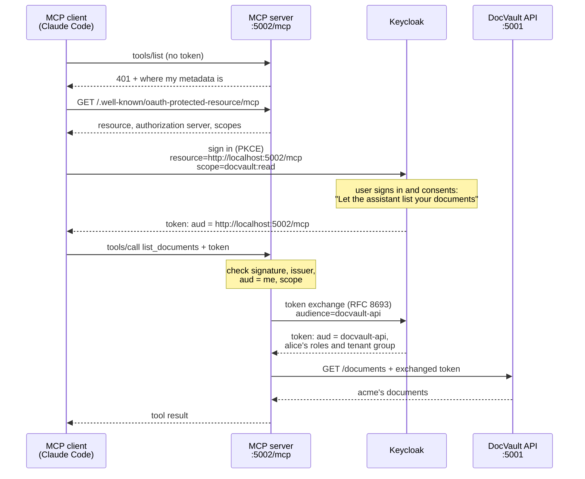

# AI assistants (MCP)

Source: `apps/mcp-dotnet/`, realm objects in `infra/terraform/20-realm/mcp.tf`.

An [MCP](https://modelcontextprotocol.io) server gives an AI assistant tools. This
one gives it three, over the DocVault API: `list_documents`, `create_document`
and `delete_document`. The interesting part is not the tools. It is that an
assistant is a new kind of client: the user did not write it, cannot read its
reasoning, and it takes instructions from whatever it reads. So the question this
chapter answers is: **what is the assistant allowed to do, on whose behalf, and
who enforces that?**

```bash
make up && make seed && make api     # as before
make mcp                             # the MCP server on :5002
make assert-mcp                      # 24 checks against the real stack
```

Then, from Claude Code:

```bash
claude mcp add --transport http --client-id docvault-mcp-client docvault http://localhost:5002/mcp
```

Run `/mcp`, authenticate as `alice`, approve the consent screen, and ask for your
documents.

> **This is a lab, and part of it is experimental upstream.** It follows the MCP
> authorization specification of 2026-07-28. Keycloak 26.6 implements the part of
> that specification this design leans on, resource indicators (RFC 8707), as an
> **experimental** feature: `resource-indicators` in `KC_FEATURES`. It is switched
> on in `infra/local/docker-compose.yml` and **not** in the Azure module, so this
> chapter is verified against the local lab and CI only.

## Three parties



| Party | Keycloak object | What it holds |
|---|---|---|
| MCP client (the assistant's host) | `docvault-mcp-client`, public, PKCE, consent required | a token for the MCP server, with scopes and **no roles** |
| MCP server | a confidential client whose `client_id` **is its URL** | a secret, used only to exchange tokens |
| DocVault API | `docvault-api`, unchanged | nothing new: it validates tokens as before |

## Two layers of permission

| Layer | Says | Set by | Enforced by |
|---|---|---|---|
| **Scopes** `docvault:read` `docvault:write` `docvault:delete` | what the *assistant* may do | the user, on the consent screen | the MCP server |
| **Roles and tenant** `doc.reader` … `/acme/engineering` | what the *user* may do | an administrator, through groups | the API, as always |

A call succeeds only where both allow it. The lab's demo users show each edge
through the assistant, and `make assert-mcp` asserts every row:

| User | Scope granted | Call | Outcome |
|---|---|---|---|
| alice (editor) | read | `list_documents` | acme's documents |
| alice | read | `create_document` | **403 challenge**: the assistant lacks `docvault:write` |
| alice | read, write, delete | `delete_document` | refused by the API: the scope is there, the admin role is not |
| carol (admin) | read, delete | `delete_document` | deleted |
| bob (other tenant) | read | `list_documents` | globex's documents only |
| dave (no roles) | read | `list_documents` | refused by the API, reported as a tool error |

The scope never widens what the user can do. Granting an assistant
`docvault:delete` does not make alice an administrator; it only means that *if*
she were one, the assistant could use that.

## The four checks the server makes

`Program.cs` and `Auth/` in `apps/mcp-dotnet/DocVault.Mcp`:

1. **The token was issued for this server.** `ValidAudience` is the server's URL,
   compared exactly. A DocVault API token, or a token for another MCP server in
   the same realm, has a good signature and issuer and is still refused.
2. **The metadata describes this server and nothing else.** One fixed document at
   `/.well-known/oauth-protected-resource/mcp` (RFC 9728) tells a client which
   authorization server to use.
3. **The token has the scope the tool needs.** If not, the answer is the challenge
   MCP specifies, `403` with `WWW-Authenticate: Bearer error="insufficient_scope",
   scope="docvault:write"`, so a client can ask the user for exactly that and retry.
4. **The token goes no further.** The server exchanges it (RFC 8693) for a token
   aimed at the API. The incoming token is never forwarded.

## Traps this found

Each of these produced no error at the point of the mistake.

- **The MCP server's `client_id` has to be its URL.** With resource indicators on,
  a token requested with `resource=http://localhost:5002/mcp` carries exactly that
  as `aud`. Keycloak's standard token exchange lets a client exchange only a token
  whose `aud` contains that client's `client_id`. A client named `docvault-mcp`
  signs users in perfectly and then fails every tool call with
  `403 access_denied "Client is not within the token audience"`. Naming the client
  after its resource makes the two agree. It looks odd in the admin console and is
  deliberate.
- **Without the feature flag nothing fails; the audience is just different.**
  Keycloak ignores `resource` when `resource-indicators` is off. Sign-in works and
  the token's `aud` comes from the audience mapper instead. `make assert-mcp`
  asserts `aud` is exactly the URL, and that an unknown `resource` is refused with
  `invalid_target`, because nothing else would notice.
- **.NET ignores a trailing slash in the audience by default.**
  `…/mcp/` and `…/mcp` are different resources and the default validator treats
  them as one. `IgnoreTrailingSlashWhenValidatingAudience = false`. A unit test
  found this, not a review.
- **The SDK's metadata follows the request.** By default the MCP C# SDK derives
  `resource` from the `Host` header and answers under any path suffix, so a
  caller could have the server describe a resource it is not. The server sets one
  fixed document; other paths are 404.
- **The SDK does not send the scope challenge.** Its authorization filters hide
  the tool and answer a call with a JSON-RPC "forbidden", which a client cannot
  act on. `ScopeChallengeMiddleware` reads the tool name from the request body and
  sends the `403` challenge. Tools stay listed whatever the scope: an assistant
  has to see a tool to ask for the permission to use it.
- **A user with no roles cannot be exchanged at all** unless the server's client
  has an audience mapper for the API: Keycloak answers
  `"Requested audience not available"`. With the mapper, dave gets a token with no
  roles and the API gives its usual 403.
- **Full scope would carry an administrator's realm roles into the exchanged
  token.** carol is a `platform-admin`. The server's client has
  `full_scope_allowed = false` and is granted only the API's document roles, so an
  assistant acting for her can delete a document and cannot reach `/admin`.

## What is not here

- **Client registration by metadata document (CIMD).** MCP prefers it; Keycloak
  26.6 has it as a second experimental feature. The client is pre-registered in
  Terraform, like the desktop clients. Dynamic client registration is deprecated
  by MCP and is not used.
- **MFA step-up for a tool.** The API's classified endpoint uses an RFC 9470 `acr`
  challenge. MCP's challenge carries scopes, not `acr` values, so there is no
  `list_classified` tool: it could not tell a client what to do.
- **A scope in the 401.** MCP suggests one. The SDK's 401 names only the metadata,
  and a client then uses the metadata's `scopes_supported`, which is `docvault:read`.
- **Azure.** `10-keycloak-azure` does not enable the feature flag and `30-azure`
  does not host this server.
- **Production hardening.** No rate limiting, no token caching, an in-memory
  document store behind it. It is a lab.

## Tests

`apps/mcp-dotnet/DocVault.Mcp.Tests` runs the real server in memory with forged
tokens: wrong audience (the API's, a sibling server's, a near miss by slash, case
or path), `alg: none`, wrong key, wrong realm, expired; every scope challenge;
that the API receives the exchanged token and never the incoming one; that
Keycloak's refusal text does not reach the assistant; and that the server refuses
to start with a missing secret, a resource URL that could never equal `aud`, or a
plain-HTTP API on another host. `tools/assert-mcp-authz.py` then proves the realm
issues what the server expects, by signing in as the demo users through the real
login page.
