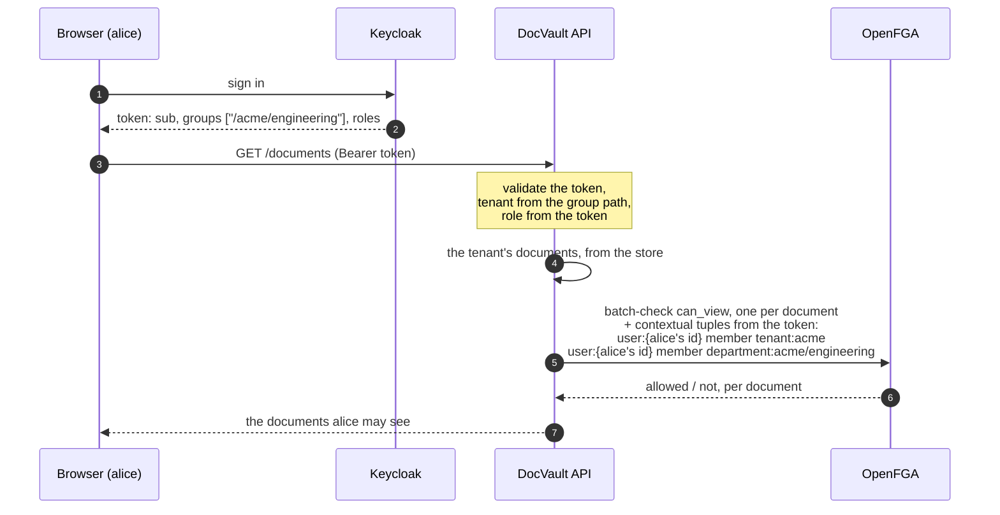

# 14. Fine-grained authorization with OpenFGA

Roles answer *"may this person edit documents?"*. They cannot answer *"may this
person see **this** document?"*, because that depends on the document: who owns
it, and who it was shared with. This chapter is how DocVault answers the second
question with [OpenFGA](https://openfga.dev), while Keycloak stays the only place
that knows who people are and where they belong. The use case is
[UC1](use-cases/uc1-rbac-document-sharing.md).

Local lab and CI only. Azure runs no OpenFGA (see [What is not here](#what-is-not-here)).

## Four questions, four answers

| Question | Answered by | From |
|---|---|---|
| Which tenant are you in? | the API (`GetTenantContext`) | the token's `groups` path |
| What kind of thing may you do? | .NET policies | the token's roles |
| Was the sign-in strong enough? | the step-up policy | the token's `acr` |
| May you do it to **this** document? | OpenFGA | stored relationships, plus memberships from the token |

Mixing these up is the usual mistake: putting roles into OpenFGA (now there are
two places to change a role), or putting relationships into the token (a token
cannot list every document someone may see). Each question is answered once,
by the part that owns it.

## The pieces



| Piece | Where |
|---|---|
| The model | `infra/openfga/docvault.fga` |
| Its tests | `infra/openfga/docvault.fga.yml` (`make test-model`) |
| The store and model, applied | `infra/terraform/25-openfga` |
| OpenFGA and its database | `infra/local/docker-compose.yml` (`openfga`, `openfga-db`, `openfga-migrate`) |
| The API's side | `apps/api-dotnet/DocVault.Api/Sharing/`, `Endpoints/ShareEndpoints.cs` |
| End to end | `tools/assert-fga.py` (`make assert-fga`) |

## The model

```
model
  schema 1.1

type user

type tenant
  relations
    define member: [user]

type department          # id: <tenant>/<department>, e.g. acme/legal
  relations
    define member: [user]

type document
  relations
    define tenant: [tenant]
    define owner: [user]
    define viewer: [user, department#member, tenant#member]
    define in_tenant: member from tenant
    define can_view: (owner or viewer) and in_tenant
    define can_share: owner and in_tenant
    define can_delete: owner and in_tenant
```

Three decisions are in those lines.

**Visibility is a share.** "Everyone in the tenant" is `tenant:acme#member` as a
viewer. A private document simply does not have that tuple.

**Every permission requires membership of the document's tenant.** A share to
someone in another tenant is therefore inert: the tuple exists and grants
nothing. The API still refuses to write one, because it would switch on the day
that person joined the tenant.

**Roles are not in the model.** Deleting is "`doc.admin`, or the owner". The
role half is read from the token by the API, as every other role is. Only the
owner half is OpenFGA's.

## Membership comes from the token, never from storage

OpenFGA could hold group membership as tuples, kept in step with Keycloak by a
sync job. DocVault does not do that. The API sends the caller's memberships with
every check as **contextual tuples**, built from the validated token:

```csharp
// Caller.From(ClaimsPrincipal): sub + the groups paths, nothing else
user:<sub> member tenant:acme
user:<sub> member department:acme/engineering
```

So there is no second copy of membership to go stale. Someone moved out of
`engineering` in the directory loses that department's shares with their next
token; with Keycloak's cache off for directory people (`ldap.tf`) that includes a
refresh. `assert-fga` moves erin out of engineering and checks exactly that.

The price is trust. **OpenFGA believes contextual tuples completely.** Measured
on v1.22.1: bob, from globex, with a share to an Acme document, is refused; the
same check with "bob is a member of acme" added as a contextual tuple is
allowed. A model test states it, so nobody mistakes it for a property of the
model. Contextual tuples are made in one place, `Caller.From`, from the token
alone, and the API checks the tenant itself before OpenFGA is asked. Either
check alone keeps bob out; `assert-fga` writes a share to bob straight into
OpenFGA and confirms both.

## Asking: batch-check, not list-objects

OpenFGA has a call made for "which documents may alice see?": `list-objects`. The
API does not use it. **It truncates silently**: with
`OPENFGA_LIST_OBJECTS_MAX_RESULTS=2` and three visible documents it returned HTTP
200 with two of them, and no flag or header saying there were more. The default
is 1000, which a busy tenant could pass.

The store already knows a tenant's documents, so the API asks about each of
those, with `batch-check`: at most 50 checks per call (more is refused, measured),
sent in chunks. A check that comes back as an error is not a "no": nothing was
decided, and the request fails.

## Failing closed, and saying so

If OpenFGA cannot answer, the API answers **503**. Never a 404 or 403 (those are
decisions, and none was made), never an empty list (which reads as "you have no
documents"), and never "allow".

- The client has a 3-second timeout and no retries. `assert-fga` freezes OpenFGA
  with `docker compose pause` and measures the 503 in about 3 seconds.
- A document whose tuples cannot be written is taken out of the store again.
  Without its tuples nobody could see it, its owner included.
- Deleting removes the tuples first. If that fails, the document is still there,
  intact.
- The OpenFGA client is a few dozen lines over HTTP rather than the SDK, so there
  is no retry loop or fallback between a failure and the 503.

## The check cache

OpenFGA can cache check results (`OPENFGA_CHECK_QUERY_CACHE_ENABLED`, off by
default). Measured with it on: a revoked share stayed **allowed**, and a new
share stayed **refused**, until the entry expired (10 seconds by default).

The API asks every check with `consistency: HIGHER_CONSISTENCY`, which skips the
cache. With the cache on and the API unchanged, all 41 `assert-fga` checks pass;
with the cache on and `HIGHER_CONSISTENCY` removed, "carol sees it now" fails.
The cache is also stated `false` in the compose file, so turning it on is a
visible decision.

## Who a share is for: an id, never a name

A share records the person's Keycloak user id (`sub`), never their username. A
username can be renamed, and it can be reused: a leaver's username given to a new
starter would carry the leaver's shares with it.

`assert-fga` renames erin in the directory. She signs in under her new name with
the same user id, the share follows her, and alice's list of shares shows the new
name. (The directory does not rewrite group members on a rename, so the check
moves the group membership too, as a real directory would.)

Turning a username into an id takes Keycloak's Admin API. The API does that as
its own client, `docvault-api-directory` (`20-realm/directory.tf`), which holds
`view-users` and nothing else, not as `docvault-api`'s service account. Asking
for someone in another tenant gets exactly the same 404 as asking for nobody, so
a share request is not a way to find out who works at globex. Keycloak is asked
only when sharing, never when reading.

Two consequences of using the directory: looking up an LDAP person who has never
signed in imports them into Keycloak, and a brokered SAML person cannot be shared
with before their first sign-in.

## Why not Keycloak's Authorization Services

Keycloak has its own fine-grained authorization, and the realm models DocVault's
documents in it ([UC1](use-cases/uc1-rbac-document-sharing.md#keycloaks-authorization-services-the-road-not-taken)).
For *sharing*, the comparison came out like this:

| | Keycloak Authorization Services | OpenFGA |
|---|---|---|
| Each document | registered in Keycloak (Protection API, the resource server's secret) | tuples pointing at the API's document id |
| Who owns the document list | Keycloak holds a copy | the API |
| Membership | Keycloak's own | Keycloak's, sent per request |
| A decision | a network call to Keycloak (UMA) | a network call to OpenFGA |
| Keycloak on the read path | yes | no |
| Policy language | policies and permissions in the admin console or Terraform | a typed model, tested on its own engine |

Neither is free: both put a network call on the request path, and both are a
service that can be down. OpenFGA is that service *instead of Keycloak*, so a
Keycloak outage stops new sign-ins but not reads with tokens already issued.

## In Terraform: the store and model, never tuples

`25-openfga` creates the store and the model, kept out of `20-realm` so that
module still talks only to Keycloak and applies unchanged to Azure. Tuples are
not in Terraform: they change at run time, and `make plan` would never be empty
again after the first share.

Measured with provider 0.5.2:

- **A model change shows as a replacement**, and the apply says "Destruction
  complete". OpenFGA cannot delete a model: the old id still answers. A
  comment-only change to the DSL is no change at all.
- **The API is pinned to one model id** (`make api` reads it from the output), so
  writing a new model does not change a running API's decisions under it.
- **The provider cannot recover from a wiped OpenFGA.** With the database volume
  removed but the state kept, it drops the missing store from state and then
  fails reading the model (`authorization_model_not_found`) on every apply.
  `make seed` forgets the state first, but only when OpenFGA itself says the
  stored id does not exist.

## Testing

Three layers, each testing what the others cannot:

| Layer | Tests | Runs |
|---|---|---|
| The model | `docvault.fga.yml`: 30 checks, 3 lists | `make test-model`, CI |
| The API's wiring | `SharingTests`, `SharingModeTests`: over a fake OpenFGA | `make test`, CI |
| Both, for real | `assert-fga.py`: 41 checks | `make assert-fga`, CI |

The fake OpenFGA in the API's tests **does not evaluate the model**. Checks are
answered from a table each test fills in, and the fake records what the API sent.
A fake that evaluated the model would be a second implementation of it, and the
tests would be testing that.

Each guard was broken on purpose to see a test fail:

| Broken | Fails |
|---|---|
| `and in_tenant` taken out of `can_view` | 2 model tests; 1 `assert-fga` check (OpenFGA's own answer for bob), while the API's check still keeps bob out |
| the API's tenant check removed | 3 API tests |
| a failed create left in the store | 1 API test |
| an outage shown as an empty list | 2 API tests |
| a per-check error read as "no" | 1 API test |
| a share keyed on the username | 2 API tests |
| a share to another tenant let through | 1 API test |
| non-path groups or unsafe names taken as departments | 1 API test each |
| seeing a document enough to delete it | 4 API tests |
| a viewer allowed to share | 1 API test |
| the check cache on and `HIGHER_CONSISTENCY` removed | 2 `assert-fga` checks |

## What is not here

- **Azure.** `30-azure` sets `Sharing__Mode=TenantOnly`: every document is
  visible to its tenant, and a private one is refused (400) rather than created
  visible to everyone. There is no default for `Sharing:Mode`; unset, the API
  refuses to start.
- **Break glass.** No administrator can see a private document. A regulated
  organisation will want an audited override.
- **Ownership transfer.** A leaver's private documents stay theirs.
- **The seeded documents have no owner**, since Keycloak picks user ids when it
  creates the realm. Nobody can share them; only an administrator deletes them.
- **Tuples outlive the in-memory store.** Documents created while the API ran are
  gone when it stops; their tuples stay in OpenFGA and grant nothing, since no
  document has those ids.
- **OpenFGA authenticates the API with a preshared key**, over plain HTTP on
  loopback. In production, use OIDC client credentials (OpenFGA supports them)
  and TLS.
- **Shares are not in the API's own audit trail** beyond its access log. The MCP
  server's audit log records the shares an assistant makes
  ([chapter on MCP](13-integration-mcp.md)).
